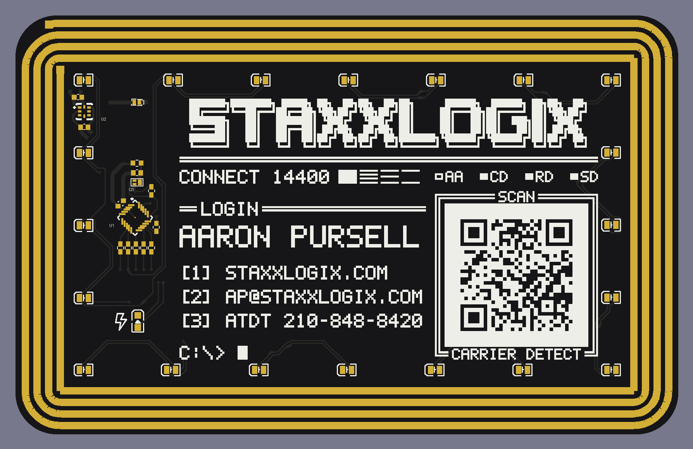

# NFC Energy-Harvesting PCB Business Card with an MCU

Like most business cards, this one doesn’t have a battery. When it’s tapped against a phone, though, 21 LEDs start an animation, powered just by NFC.

**Find more information at [wlsn.ee/nfc](https://wlsn.ee/nfc).**

## Details

* MCU: ATtiny816 
* NFC Chip: NXP NTAG I2C Plus
* Antenna: Custom rectangular coil tuned to ~2.75 µH
* Display: 21 Charlieplexed LEDs
* Dimensions: Payment card form factor

## Repository Layout

* `hardware/` - KiCad 9.0 schematic files/PCB layout files and 3D models
* `software/` - firmware and KiPython script
* `gallery/` - photos/video of card

## Programming

The ATtiny is flashed over UPDI; its clock speed should be set to 1 MHz. The NFC chip is formatted and written using [NXP Tagwriter](https://play.google.com/store/apps/details?id=com.nxp.nfc.tagwriter&hl=en_US). Energy harvesting is enabled by default, and it is easy to add vCard records or a website link.

## This fork

Modified by Aaron Pursell, 2026-10-07 (notice under CERN-OHL-S-2.0 §3.3(b)). This is a fork of
[WiHarper/nfc_card](https://github.com/WiHarper/nfc_card); the electrical design is unchanged.

What changed:

* `hardware/Business Card v2.kicad_pcb`: new retro (1993 BBS / dial-up modem) front silkscreen
  for Aaron Pursell / StaxxLogix, replacing the original front artwork. It has an ANSI-Shadow
  logo, contact details as a numbered menu, and a QR code for https://staxxlogix.com/.
  Silkscreen only: no copper, mask or footprint was touched.
* Back silkscreen: the original designer's credit is kept word for word ("MADE BY / WILSON
  HARPER" and the heart), redrawn in a pixel font. Below it the fork adds "REMIX: AARON PURSELL"
  and "OPEN HW CERN-OHL-S-2.0", plus a source notice ("SRC: GITHUB.COM/NASTEA1/NFC_CARD").
* Title block of the board: Wilson Harper's lines are unchanged. The fork adds a modification
  notice (comment 3), a licence/source line (comment 4) and rev `2-ap1`. Note that the original
  comment 2 says GPL v3.0, but `LICENSE.md` puts `hardware/` under CERN-OHL-S-2.0.
* The board is designed for **black soldermask with white silkscreen**. The stackup colours in
  the .kicad_pcb are set to match, but the mask colour must also be chosen in the fab order.
* `tools/silk/`: scripts that generate, check (DFM, QR decode) and write the silkscreen
  (`apply_final.py` regenerates the board from commit 57a460f), with previews in
  `tools/silk/previews/`.

**Before ordering boards:** the card prints `github.com/nastea1/nfc_card` as the source location.
CERN-OHL-S-2.0 (§1.9, §3.3(c), §4) requires that location to be publicly accessible to everyone
who receives a card, for at least three years. So, before the cards are handed out, that
repository must be public and its default branch must contain this modified design. Also select
**Black** soldermask and **White** silkscreen on the fab order form. The stackup colours in the
.kicad_pcb do not reach the fab, and on a light mask the inverted QR prints with reversed polarity.

