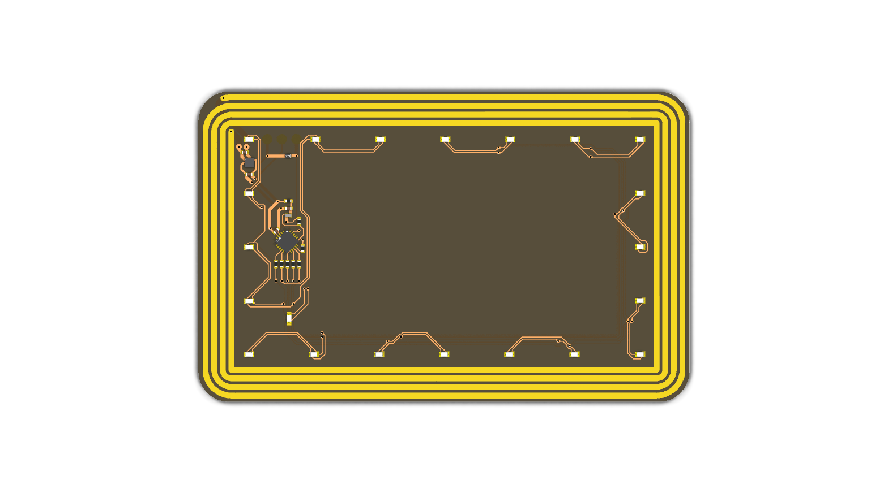
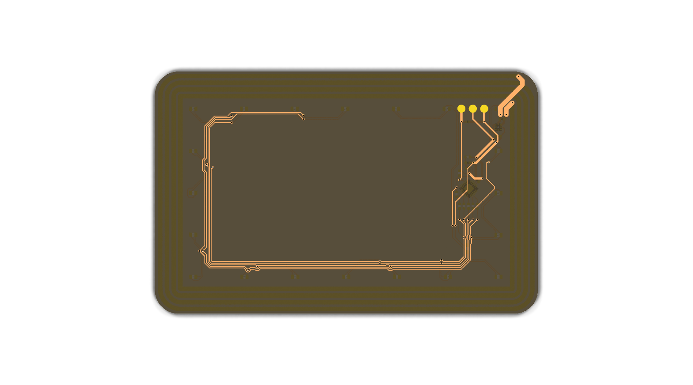

# NFC Energy-Harvesting PCB Business Card with an MCU

Like most business cards, this one doesn’t have a battery. When it’s tapped against a phone, though, 21 LEDs start an animation, powered just by NFC.

**Find more information at [wlsn.ee/nfc](https://wlsn.ee/nfc).**

## Details

* MCU: ATtiny816 
* NFC Chip: NXP NTAG I2C Plus
* Antenna: Custom rectangular coil tuned to ~2.75 µH
* Display: 21 Charlieplexed LEDs
* Dimensions: Payment card form factor

## Repository Layout

* `hardware/` - KiCad 9.0 schematic files/PCB layout files and 3D models
* `software/` - firmware and KiPython script
* `gallery/` - photos/video of card

## Programming

The ATtiny is flashed over UPDI; its clock speed should be set to 1 MHz. The NFC chip is formatted and written using [NXP Tagwriter](https://play.google.com/store/apps/details?id=com.nxp.nfc.tagwriter&hl=en_US). Energy harvesting is enabled by default, and it is easy to add vCard records or a website link.

## This fork

Modified by Aaron Pursell, 2026-10-07 (notice under CERN-OHL-S-2.0 §3.3(b)). This is a fork of
[WiHarper/nfc_card](https://github.com/WiHarper/nfc_card); the circuit is unchanged (same nets,
footprints and copper).

What changed:

* `hardware/Business Card v2.kicad_pcb`: new retro (1993 BBS / dial-up modem) front silkscreen
  for Aaron Pursell / StaxxLogix, replacing the original front artwork. It has an ANSI-Shadow
  logo, contact details as a numbered menu, and a QR code for https://staxxlogix.com/.
  Silkscreen only: no copper, mask or footprint was touched.
* Back silkscreen: the original designer's credit is kept word for word ("MADE BY / WILSON
  HARPER" and the heart), redrawn in a pixel font. Below it the fork adds "REMIX: AARON PURSELL"
  and "OPEN HW CERN-OHL-S-2.0", plus a source notice ("SRC: GITHUB.COM/NASTEA1/NFC_CARD").
* Title block of the board: Wilson Harper's lines are unchanged. The fork adds a modification
  notice (comment 3), a licence/source line (comment 4) and rev `2-ap1`. Note that the original
  comment 2 says GPL v3.0, but `LICENSE.md` puts `hardware/` under CERN-OHL-S-2.0.
* The board is designed for **black soldermask with white silkscreen**. The stackup colours in
  the .kicad_pcb are set to match, but the mask colour must also be chosen in the fab order.
* **LEDs:** the 20 animation LEDs (LED1-LED20) are **amber** XINGLIGHT XL-1608UYC-06FJ
  (LCSC C7371901, 600 mcd, Vf 1.9-2.3 V), replacing the red XL-1608SURC-06FJ (C7371900). It is
  the same family and brightness as the red, and the same part as the existing indicator LED22.
  The phosphor-green XL-1608SYGC-06 (C965805) was considered and rejected: at 60 mcd it is ten
  times dimmer on NFC-harvested power. Only the part fields changed; the footprint stays
  `XL-1608SURC-06FJ`. Its pad 1 is the anode and the amber datasheet calls the cathode pin 1, but
  in both footprints the **cathode is the -x pad**, so the polarity is unchanged (see
  `tools/bom/leds.py`).
* **BOM fix:** R4 (100 R 0402, a charlieplex resistor) had no LCSC number in the original, so a
  JLCPCB BOM built from the files left it unplaced. It now carries C25076, like R1/R5/R6/R7
  (`tools/bom/fixes.py`).
* **BOM fix:** C1 (the 1.5 pF antenna tuning cap, 0402 footprint) pointed at C1639, which is an
  **0603** part (0603CG1R5C500NT). It is now C1552 (0402CG1R5C500NT): same maker, series, C0G
  and tolerance, in the 0402 size the footprint needs.
* `tools/fab/make_fab.sh`: builds `fab/gerbers.zip`, `fab/bom_jlc.csv` and `fab/cpl_jlc.csv`
  with kicad-cli (37 placed parts, 12 BOM lines; one line per LCSC part).
* `tools/silk/`: scripts that generate, check (DFM, QR decode) and write the silkscreen
  (`apply_final.py` regenerates the board from commit 57a460f), with previews in
  `tools/silk/previews/`.

**Before ordering boards:** the card prints `github.com/nastea1/nfc_card` as the source location.
CERN-OHL-S-2.0 (§1.9, §3.3(c), §4) requires that location to be publicly accessible to everyone
who receives a card, for at least three years. So, before the cards are handed out, that
repository must be public and its default branch must contain this modified design. Also select
**Black** soldermask and **White** silkscreen on the fab order form. The stackup colours in the
.kicad_pcb do not reach the fab, and on a light mask the inverted QR prints with reversed polarity.

**JLCPCB order:** upload `fab/gerbers.zip`. Choose 2 layers, thickness 0.8 mm, **Black**
soldermask, **White** silkscreen and **ENIG** finish. For assembly (top side) upload
`fab/bom_jlc.csv` and `fab/cpl_jlc.csv`. In the placement preview, check that every LED's cathode
mark is on the same side as on the red original (the -x pad) and that R4 is placed.

Verified with KiCad 10 kicad-cli against the original board. DRC with schematic parity and ERC
counts are identical per category (45 / 106, all pre-existing: antenna-footprint clearance, missing
courtyards, library and pin-type warnings). There are 0 silk-over-copper and 0 silk-edge findings.

### Firmware

`software/nfc_card.ino` replaces the original single counter-clockwise comet with a
four-phase light show that suits the StaxxLogix (Las Vegas) theme: a fast four-dot spin
(a casino wheel), random sparkle twinkles, full-ring strobe bursts, and two comets sweeping
in opposite directions, cycling in that order. Each LED's brightness is set by its dwell
time during the Charlieplex multiplex pass, and the show advances on a fixed 28 ms time base
so the pace is independent of render time. The power/indicator LED is unchanged: it breathes
for the first ten seconds, then blinks the "STAXXLOGIX.COM" Morse easter egg. Build with
megaTinyCore for the ATtiny816 at 1 MHz internal and flash over UPDI.

### NFC provisioning

The NTAG I2C Plus is written over the air (its I2C side is not wired to the MCU, so there is
no UPDI path to it). For a contact card that reads well on both phone platforms, the tag is
written with a two-record NDEF message:

* a `text/vcard` record first, so Android opens "add contact" natively on tap, and
* a URI record pointing at a hosted `.vcf`, so iPhone (which only acts on a URI record in the
  background) opens the contact.

The tag is then write-protected with the NTAG's 32-bit password (AUTH0 set to the first NDEF
page, NFC_PROT = 0 so the card stays readable). This is reversible: the holder keeps a
tamper-proof card but the owner can still rewrite it with the PIN.

`provisioning/write_card.py` writes and locks a card with an ACR122U reader over PC/SC
(pyscard). Fill in your own contact details, hosted .vcf URL and PIN at the top of the file.
Notes:

* Fresh NTAG I2C Plus ships with a blank capability container (page 3 all zero); the script
  writes `E1 10 6D 00` before the NDEF.
* A phone often cannot complete a write against the card's energy-harvesting load (it browns
  out mid write); a USB reader with a stronger, steadier field does it reliably.
* Do not set the static or dynamic lock bytes unless you want the tag permanently read only.
  Those are one-way over NFC and can only be cleared from the chip's I2C side, which is not
  broken out on this board.
